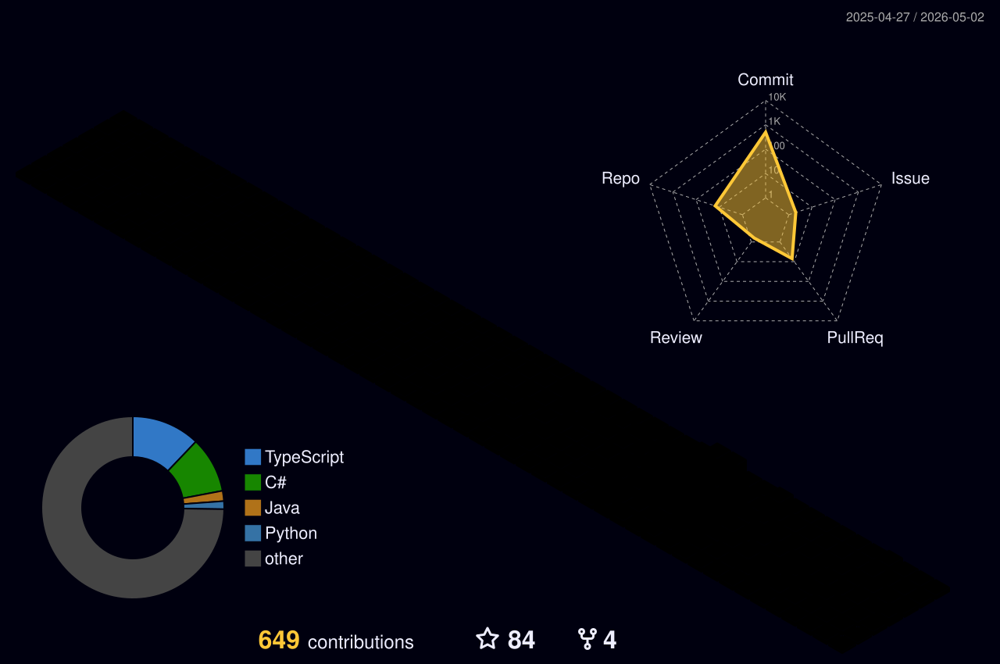

  

  

- 🌱 I’m currently focused on **Nacos Spring AI Event Mesh and Agent Scope-Java **.
- 📫 How to reach me **karson@apache.org**

<h3 align="left">Languages and Tools:</h3>

                

&nbsp;

### 📈 My github stats:

---

## 开奖笔记 · 轮盘（GitHub Pages）

单文件静态站点 [`index.html`](./index.html)，通过 **GitHub Pages** 公网访问。

- **地址（启用 Pages 后）：** [https://karsonto.github.io/](https://karsonto.github.io/)

### 开启 Pages

1. 仓库 **Settings → Pages**
2. **Build and deployment**：使用本仓库工作流时选 **GitHub Actions**（推送 `main` 后触发 [`.github/workflows/pages.yml`](./.github/workflows/pages.yml)）；或选 **Deploy from a branch**：**main** / **/(root)**
3. 等待数分钟后访问上述地址

### 免责声明

页面内策略与推演为启发式示意，不构成真实概率或可依赖的下注依据。
